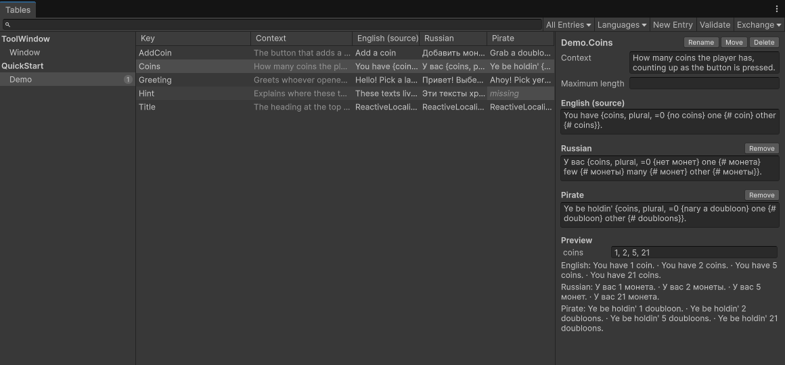

### About ReactiveLocalizer

Localization for Unity that scales from a five-minute prototype to hundreds of thousands of entries, with no dependencies.



Text lives in plain `.lang` files, one per table and language, that diff, merge and review like code. The editor compiles them into compact tables, generates keys the compiler checks, and gives messages with arguments typed methods, so a mistyped key or a renamed argument fails at compile time, never in front of players.

Bindings follow every language switch without allocating or polling, invented and fan-made languages work like real ones, and a table window, Inspector fields, validation, and exchange with spreadsheets, translation tools and language models cover the whole workflow, from the first entry to a shipped translation.

### Features

1. Text files that diff and merge.
2. Keys the compiler checks.
3. ICU plurals, selects and numbers.
4. Bindings that allocate nothing.
5. A table window for all languages.
6. Inspector fields that create entries.
7. Live preview in Edit Mode.
8. Validation that gates builds.
9. XLSX, CSV, XLIFF and LLM exchange.
10. Invented and runtime languages.
11. Tables loaded on demand or streamed.
12. Renames that never break references.
13. Pseudo-localization and font sets.
14. CLDR plural rules, no CultureInfo.
15. Every platform, WebGL included.
16. 11 samples, from TextMeshPro to mods.

Detailed about features - see [FEATURES.md](Documentation/FEATURES.md).

### Performance

**Reading a text takes about 55 ns and allocates nothing,** a plural message formats into a buffer in about 0.55 µs, and switching the language of 1,000 bound texts takes 0.46 ms, in an IL2CPP build on a desktop with an Intel Core i7-12700K. A frame where no text changes costs one flag check.

**A 50,000-entry dialogue table loads in about 4 ms** and takes 7.3 MB, 2 bytes per character plus 24 per entry, and strings are created only for the lines actually shown. Compiling it, which its import does in the editor, takes about a quarter of a second.

Detailed about performance - see [PERFORMANCE.md](Documentation/PERFORMANCE.md).

### Requirements

1. Unity 2022.3 or later.
2. No other packages; samples need theirs.
3. Git, only for *Show source change*.
4. Unity Web Request, to stream on Android and WebGL.

### Limitations

1. Strings only, no localized assets.
2. No right-to-left shaping, only a hint.
3. Dates and currency need formatters.
4. Number styles: plain, integer, percent.
5. ICU MessageFormat 1, not 2.
6. XLIFF 1.2 skips control characters.
7. Custom-delivered tables have no pseudo text.

### How to install

**From the git URL:** in **Window > Package Manager**, choose **+ > Install package from git URL** and enter the URL below. Add `#1.0.0` to its end to stay on that version.

```
https://github.com/reromanlee/ReactiveLocalizer.git?path=/UnityPackage
```

**From a tarball:** download the `.tgz` file of the [latest release](https://github.com/reromanlee/ReactiveLocalizer/releases/latest), then in **Window > Package Manager** choose **+ > Install package from tarball** and pick it.

**Then import the samples you need** from the package's **Samples** tab, Quick Start first.

Migrating from Unity Localization - see [MIGRATION.md](Documentation/MIGRATION.md).

### How to use

**Add a table, then write entries in the table window or in the file itself.** **Assets > Create > ReactiveLocalizer > Table** creates `NewTable.English.lang`, and in a new project the default catalog with it; rename it after its feature, such as `MainMenu.English.lang`. Each entry is a line, the comment above it is what translators see, and translations go in `MainMenu.Russian.lang`.

```
# The button that starts a new game.
Play = Play

# How many coins the player has, under the button.
Coins = You have {coins, plural, one {# coin} other {# coins}}.
```

**Read or bind text through the keys the editor generates.** A binding calls its callback right away, and again whenever the text changes, a language switch included, without allocating; dispose it when the UI hides. A switch loads the new language first and then changes every text in the same frame.

```csharp
using reromanlee.ReactiveLocalizer;
using reromanlee.ReactiveLocalizer.Unity;

Localizer localizer = new Localizer(LocalizationKeys.CatalogKey, new UnityHost());
await localizer.InitializeAsync();

TextBinding play = localizer.Bind(LocalizationKeys.MainMenu.Play, _playLabel, static (label, text) => label.text = text);
string coins = localizer.Get(LocalizationKeys.MainMenu.Coins(coins: 5));

await localizer.SetLanguageAsync(LocalizationLanguages.Russian);
```

**Or skip the code:** import the Quick Start and TextMeshPro samples, add **Localized TextMeshPro** to a text, and pick its entry in the Inspector, which searches every key and text and creates missing entries on the spot. The Scene view's **Preview Language** overlay shows every language, `Pseudo` included, live in Edit Mode, and **Tools > ReactiveLocalizer > Export** hands translators an XLSX, CSV or XLIFF file, or a language model the entries it should translate.

Detailed about usage - see [USAGE.md](Documentation/USAGE.md).

The exact rules of `.lang` and `.catalog` files - see [FORMAT.md](Documentation/FORMAT.md).

### License

Made by Roman Likhadievski ([reromanlee.com](https://reromanlee.com)).

Licensed under MIT - see [LICENSE.md](LICENSE.md).
